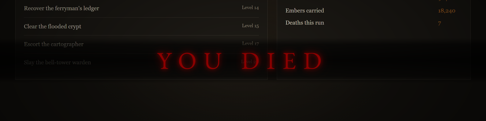
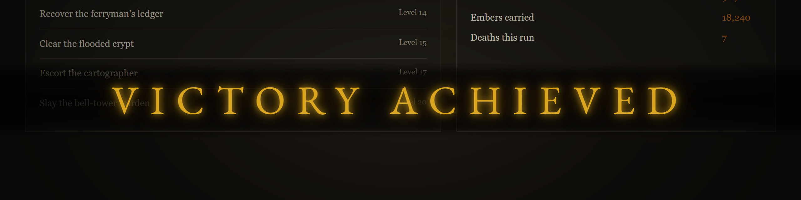
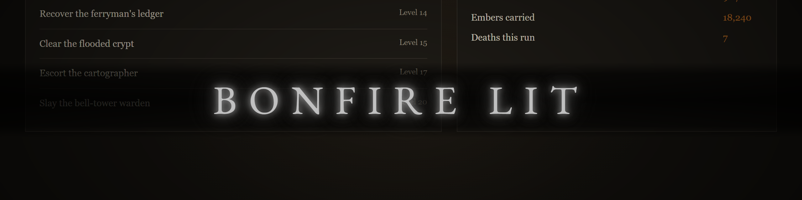
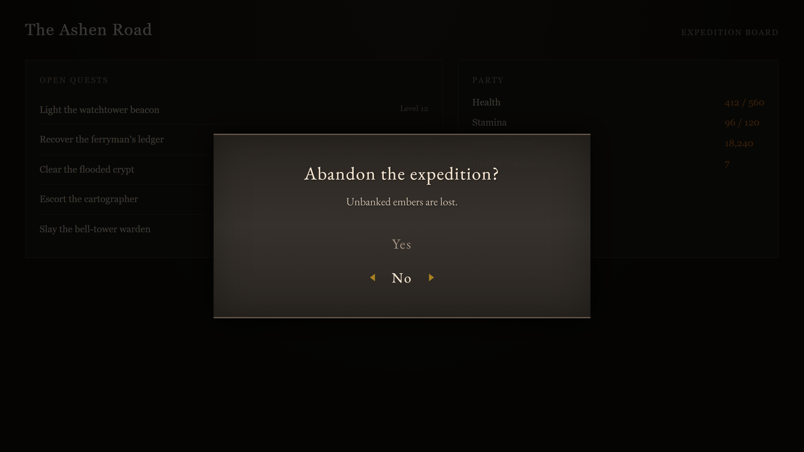
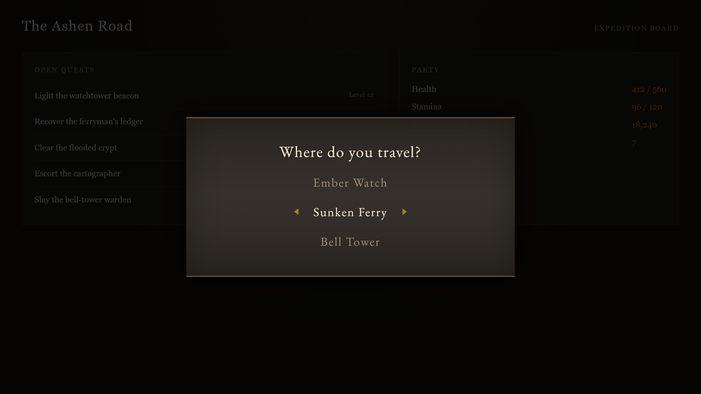

# Bonfire

Dramatic full-screen notifications and dialogs inspired by Soulsborne games: death and victory banners, an "online" status banner, and keyboard-driven confirm and choice dialogs with a promise-based API. No dependencies, no framework required.



Every image here is captured from `examples/showcase.html`; see [Development](#development).

## Installation

```bash
npm i @ozankurt/bonfire
```

### Script tag

```html
<script src="https://cdn.jsdelivr.net/npm/@ozankurt/bonfire@1/dist/bonfire.min.js"></script>
<script>
    Bonfire.death();
</script>
```

The browser build exposes the API as `window.Bonfire`.

### ES modules

```js
import Bonfire from '@ozankurt/bonfire';

Bonfire.success('BOSS DEFEATED');
```

Importing the module does not touch the DOM; styles are added to `<head>` the first time a notification or dialog is shown.

## API

### `configure(options)`

See [Configuration](#configuration).

### `notify(message, options)`

Full-screen message with a glow effect. Returns a cleanup function that dismisses it immediately.

| Option | Type | Default | Description |
|---|---|---|---|
| `type` | `'death' \| 'success' \| 'info'` | `'info'` | Red, gold or silver glow |
| `duration` | `number` | `3000` (see `configure`) | Display time in ms; `0` keeps it until cleanup is called |
| `backdrop` | `boolean` | `true` | Show the dark backdrop band |
| `onComplete` | `function` | `null` | Called once the notification has been removed |

### `death(message = 'YOU DIED', options)`, `success(message = 'VICTORY ACHIEVED', options)`, `info(message, options)`

Shortcuts for `notify` with the matching `type`. Same options and return value.

| `success()` | `info()` |
|---|---|
|  |  |

### `online(message, options)`


Elden Ring style status banner. Returns a cleanup function.

| Option | Type | Default | Description |
|---|---|---|---|
| `subtitle` | `string` | `null` | Smaller line under the message |
| `duration` | `number` | `3000` (see `configure`) | Display time in ms |
| `onComplete` | `function` | `null` | Called once the banner has been removed |

### `confirm(message, options)`



Yes/No dialog. Resolves `true` or `false`. "No" is selected by default, and Escape resolves `false`.

| Option | Type | Default | Description |
|---|---|---|---|
| `subtitle` | `string` | `null` | Smaller line under the question |
| `yesLabel` | `string` | `'Yes'` | Label of the confirming button |
| `noLabel` | `string` | `'No'` | Label of the declining button |
| `onYes` | `function` | `null` | Called when "Yes" is chosen |
| `onNo` | `function` | `null` | Called when "No" is chosen or the dialog is cancelled |

```js
if (await Bonfire.confirm('Delete this record?')) {
    // ...
}
```

### `choice(message, options)`



Multiple choice dialog. Resolves with the chosen option's `value`, or `cancelValue` on Escape. Arrow keys move the selection; Enter or Space chooses.

| Option | Type | Default | Description |
|---|---|---|---|
| `options` | `{ label, value }[]` | one `OK` option (value `true`) | The choices; an empty list also gets the single `OK` option |
| `subtitle` | `string` | `null` | Smaller line under the question |
| `defaultIndex` | `number` | `0` | Initially selected option |
| `cancelValue` | `any` | `null` | Resolved value when cancelled |
| `onSelect` | `function(value)` | `null` | Called with the chosen value |
| `onCancel` | `function` | `null` | Called when cancelled |

## Configuration

```js
Bonfire.configure({
    duration: 5000,   // default display time for notify/online, in ms (default 3000)
    fontUrl: null,    // stylesheet URL for the EB Garamond font, or null to skip it
});
```

Call `configure()` before the first notification or dialog: the stylesheet and the font `<link>` are added once, on first use. An explicit `duration` passed to a call (including `0`) always wins over the configured default. Invalid values (a negative or non-numeric `duration`, an `undefined` option) are ignored and keep the current default.

### Self-hosting the font

By default the stylesheet imports EB Garamond from Google Fonts, which sends each visitor's IP address to Google and needs `fonts.googleapis.com` / `fonts.gstatic.com` in your Content Security Policy. To avoid that, serve the font yourself and point `fontUrl` at your own stylesheet, or set it to `null` and load the font however you like:

```js
Bonfire.configure({ fontUrl: '/fonts/eb-garamond.css' });
```

## Styling

All elements use `darksouls-*` class names (for example `.darksouls-message.death`, `.darksouls-confirm-btn.selected`), so you can override them in your own CSS. The injected stylesheet has the id `darksouls-styles`.

## Development

```bash
npm install
npm test
npm run build        # dist/, which is committed; rebuild it before tagging a release
npm run examples     # the showcase on http://localhost:5182/showcase.html
npm run screenshots  # recapture docs/images/ from the showcase
```

The showcase takes `?scene=death|victory|info|online|confirm|choice`.

## License

MIT
